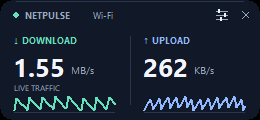
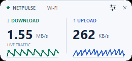

# NetPulse

A small, draggable Windows widget for live download and upload rates. Built
with Python, Tkinter, and the native Windows network-counter API.


## Features

- Mini mode: a header-free **226 × 38 logical-pixel** strip with two readings.
- Dark, light, and follow-Windows themes, plus four accent colors.
- Adjustable corner radius, transparency, widget size, and always-on-top mode.
- Bits or bytes, configurable refresh intervals, and optional activity graphs.
- Automatic physical-adapter selection or a manually selected adapter.
- Saved position and preferences; no account, telemetry, or runtime downloads.




Screenshots show sample traffic values. Windows display scaling affects physical size.

## Website

The dedicated landing page lives in [site/](site/), with an interactive Mini
widget preview, dark/light themes, screenshots, and source-download instructions.
See [WEBSITE.md](WEBSITE.md) for local preview, checks, and GitHub Pages setup.
The Pages workflow publishes only the website files after Pages is enabled and
the changes are pushed to `main`.

## Run from source

Requires Windows 10/11 x64 and Python 3.10+ with Tcl/Tk installed. The app uses
only the Python standard library; no additional runtime packages are needed.

From the repository root, run:

```powershell
python source/app.py
```

Drag the widget to move it. Right-click and choose **Customize** to change its
appearance, units, or adapter. Mini mode has no title or buttons; use its
right-click menu to customize or exit. `Ctrl+,` opens settings and `Ctrl+Q`
exits while the widget has focus.

Preferences are saved in `%LOCALAPPDATA%\NetPulse\settings.json`. To use a
separate configuration:

```powershell
python source/app.py --config ./settings.json
```

Only one widget runs per Windows session. See [the user guide](README.txt)
for all controls and behavior.

## What the readings measure

NetPulse measures current adapter traffic using differences in 64-bit Windows
byte counters divided by actual elapsed time. It includes local-network traffic
and protocol overhead; it does not measure your connection's maximum capacity.
Idle traffic can be zero on a fast connection. `8 Mbps = 1 MB/s`.

Automatic mode excludes virtual and VPN layers to reduce duplicate counting.
Select an adapter manually when using a virtual machine or when a particular
interface is needed. After reconnects, counter resets, or long pauses, NetPulse
briefly measures a new baseline before showing rates.

## Develop and build

From the repository root, create a development environment:

```powershell
python -m venv .venv
.\.venv\Scripts\python.exe -m pip install -r requirements-dev.txt
Set-Location source
..\.venv\Scripts\python.exe -m unittest discover -s tests -v
..\.venv\Scripts\python.exe -m ruff check .
..\.venv\Scripts\python.exe -m ruff format --check .
```

The full test suite needs a Windows desktop session with Tk available. Build
the portable executable from `source` in that same environment:

```powershell
..\.venv\Scripts\python.exe -m PyInstaller --clean --noconfirm --onefile --windowed --name NetPulse --icon NetPulse.ico --add-data "NetPulse.ico;." app.py
```

The result is `source/dist/NetPulse.exe`. See [development notes](source/BUILDING.txt),
[validation records](VALIDATION.md), and [contribution and release instructions](CONTRIBUTING.md).

## Repository layout

| Path | Contents |
| --- | --- |
| `source/` | App code, icon, tests, and implementation notes |
| `previews/` | Screenshots of the working app with sample readings |
| `site/` | Static GitHub Pages landing page and its assets |
| `tests/` | Website regression tests, separate from app tests |
| `.github/workflows/pages.yml` | GitHub Pages deployment workflow |
| `README.txt` | Portable app user guide |
| `requirements-dev.txt` | Pinned lint and packaging tools |

Generated executables, release archives, local configuration, and scratch files
are excluded from Git. A local checkout may contain preserved copies of those files.

## Known limitations

There is no tray integration, startup registration, per-process measurement, or
Internet-only filtering. Moving between monitors with different DPI settings may
require a restart for optimal sizing. Canvas readings do not provide full
screen-reader semantics. Windows 10 and mixed-DPI hardware have not been physically
validated; the validation record distinguishes automated and manual checks.

## License

NetPulse source is available under the [MIT License](LICENSE). Bundled runtimes
retain their own licenses; see the release instructions before distributing an executable.
